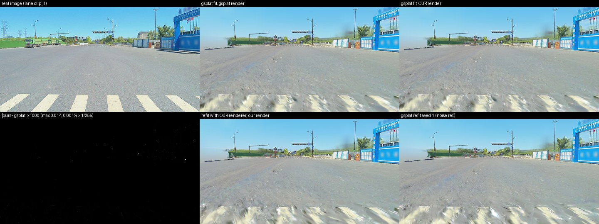

# Our own Gaussian-splat renderer (hybrid)

Code: `src/splats/own_render.py` (renderer), `src/splats/torch_ref_render.py` (pure-PyTorch reference),
`src/splats/own_render_check.py` (validation), `src/splats/own_render_eval.py` + `own_render_summary.py` +
`own_render_figure.py` (refit evaluation), `scripts/21_own_renderer.sh` (entry point). Training with it:
`src/splats/fit_splat.py ... --renderer own` (default stays `gsplat`, so every earlier result is unchanged).
Numbers: `results/own_renderer/` (check.json, summary.json, eval/ntl rows, summary_scene_16.md, figure).

## What is ours and what is gsplat's
`own_render.render` is a drop-in replacement for `splats.gs.render` (same inputs, same `rgb, alpha, depth, info`).

| step | who | notes |
|---|---|---|
| camera chain: viewmat = c2w⁻¹, world → camera for the centers | **ours** (PyTorch) | pose gradient flows through autograd |
| depth culling (near 0.01 m / far plane) | **ours** | before any covariance work: only Gaussians in front are processed |
| 3D covariance Σ = R S Sᵀ Rᵀ from wxyz quaternion + log-scales | **ours** | written as Σ = A Aᵀ, A = R·diag(exp s), rotated to the camera as R_cam A |
| EWA projection: 2D covariance J R_cam Σ R_camᵀ Jᵀ with the perspective Jacobian | **ours** | gsplat's clamp of x/z, y/z to 1.3× the field of view |
| low-pass dilation (+0.3 px² on the diagonal, "classic" mode, as D uses) | **ours** | "antialiased" opacity compensation also written (unused) |
| conic (inverse 2D covariance), 3σ radius from the largest eigenvalue, off-screen / degenerate culling | **ours** | exactly gsplat 1.4's rules |
| SH degree 0–3 → RGB (+0.5, clamp ≥ 0), view direction from the camera center | **ours** | same basis/signs as gsplat |
| expected depth (Σ w z / α) and sky environment map composited with (1 − α) | **ours** | as `gs.render` |
| densification info (`means2d` [1,N,2] with retained grad, `radii`, `width/height/n_cameras`) | **ours** | gsplat's non-packed layout, so `DefaultStrategy` works unchanged |
| tile intersection + global (tile, depth) sort: `isect_tiles`, `isect_offset_encode` | gsplat | CUDA |
| per-pixel front-to-back alpha compositing and its backward: `rasterize_to_pixels` | gsplat | CUDA; returns gradients w.r.t. our 2D means, conics, colors, opacities |

`torch_ref_render.py` replaces the two gsplat pieces with plain PyTorch (tile binning with gsplat's tile bounds,
stable sort by (tile, depth), chunked front-to-back compositing with gsplat's exact rules: α = min(0.999, o·e^{-σ}),
skip σ < 0 or α < 1/255, stop the pixel once T(1−α) ≤ 1e-4). It shares our projection and SH, so "reference vs
gsplat" checks the whole pipeline and "reference vs ours" isolates gsplat's two kernels. It is slow (Python loop over
depth chunks) and meant for small crops only.

D uses gsplat **1.4.0** (proposal C's prototype targeted 1.5.3). Differences that mattered for the port: radii are one
integer per Gaussian (not per axis), the radius is ceil(3·sqrt(λ_max)) with no opacity term, and there is no opacity
culling; C's prototype followed 1.5's opacity-aware radius and was changed accordingly.

## Validation on D's fitted splats (`scripts/21_own_renderer.sh check`)
Splats: `scene_16/clip_0/splat.pt` (1,403,395 Gaussians) and `scene_17/clip_0/splat.pt` (1,134,058), the existing
gsplat fits. 24 full frames (960×540): per scene 4 held-out on-path frames (0 m), 4 frames at the ~3 m lane and 4 at
the ~6 m lane (real poses from the pairs `meta.json`, evenly spaced along the path). RTX 3090, float32.

**Forward (own vs gsplat, with depth):**

| | scene_16 | scene_17 |
|---|---|---|
| RGB mean abs diff | 8.1e-7 | 1.3e-6 |
| RGB max abs diff (worst pixel over 12 frames) | 0.076 | 0.036 |
| pixels whose 8-bit PNG value differs | 0.05% | 0.08% |
| PSNR(own vs gsplat), mean / worst frame | 88.9 / 80.0 dB | 92.7 / 76.4 dB |
| alpha mean / max abs diff | 1.1e-6 / 0.0039 | 1.2e-6 / 0.0039 |
| expected depth mean / max abs diff (pixels with α > 0.5) | 6.0e-6 / 0.18 m | 8.4e-6 / 0.11 m |
| visible Gaussians / tile intersections, summed over the 12+12 frames | 10,518,285 vs 10,518,284 visible; 38,631,569 vs 38,631,562 tile intersections (all frames) | |

The mean differences are float round-off (different operation order: we form Σ_c via R_cam·A instead of R Σ Rᵀ).
The rare larger single-pixel differences come from threshold flips: a Gaussian whose radius lands exactly on an
integer (one extra tile) or whose α sits at 1/255, or a pixel whose transmittance crosses 1e-4 one Gaussian earlier,
changes what is composited behind it. They are invisible in side-by-side renders (figure below).

**Gradients** of a photometric loss (L1 vs the real image of the target lane, movable objects masked, depth rendered
as in training), cosine similarity own vs gsplat over all 24 frames:

| means | log-scales | quats | logit-opacities | sh0 | shN | sky texture | camera pose (c2w) | 2D means (densification) |
|---|---|---|---|---|---|---|---|---|
| ≥ 0.99996 (mean 0.999996) | ≥ 0.999998 | ≥ 0.999999 | ≥ 0.999997 | ≥ 0.999997 | ≥ 0.999997 | 1.000000 | ≥ 0.9999996 (mean 1.000000) | ≥ 0.99996 |

Gradient norm ratios are 1 ± 1e-4 (pose 1 ± 1.3e-3). SH evaluation alone (random input, degrees 0–3) matches
gsplat's `spherical_harmonics` kernel to 2.4e-6 with gradient cosines 1 − 3e-14.

**Densification statistic:** DefaultStrategy grows Gaussians whose accumulated normalized screen-space gradient
exceeds 2e-4. Per frame, the per-Gaussian statistic has cosine ≥ 0.99997 and the grow/no-grow decision agrees for
≥ 99.9995% of Gaussians (117,594 vs 117,599 above threshold over the 24 frames).

**Pure-PyTorch reference, 64×64 crops** (12 crops: road, horizon, roadside × 2 frames × 2 scenes; values, then
gradient cosines w.r.t. means / scales / quats / opacities / SH / pose / sky):

| pair | RGB max abs | α max abs | depth max abs | worst gradient cosine |
|---|---|---|---|---|
| reference vs ours (isolates gsplat's two kernels) | 8.3e-7 | 6.0e-7 | 2.5e-5 m | 0.9999965 |
| reference vs gsplat (whole pipeline) | 6.2e-4 | 8.5e-4 | 2.1e-3 m | 0.9999998 |
| ours vs gsplat | 6.2e-4 | 8.5e-4 | 2.1e-3 m | 0.9999965 |

So our PyTorch half is equivalent to gsplat's fused projection, and gsplat's two kernels behave exactly as the
reference compositing written from the paper's equations.

**Speed and memory** (per 960×540 frame, same frames; forward = eval render without depth, forward+backward =
training step with depth and the L1 loss; peak = extra memory over the loaded splat):

| | gsplat | ours (hybrid) | ratio |
|---|---|---|---|
| forward, mean (median) ms | 5.4 (3.9) | 8.6 (6.1) | 1.5× slower |
| forward+backward, mean (median) ms | 15.9 (12.4) | 28.9 (21.9) | 1.7× slower |
| peak extra memory, mean (max) MiB | 633 (700) | 626 (1,362) | ≈ same on average, up to 2× on frames that see the whole splat |
| pure-PyTorch reference on a 64×64 crop, fwd+bwd | 7.0 ms | 22 ms (ours) | reference 54 ms |

Our first version formed Σ and the 2D covariance with `torch.matmul` on millions of 3×3 matrices; batched GEMMs
and their backward took 83% of the time (266 ms per training step, 12× gsplat). Writing the tiny products as
broadcast multiply + sum (`small_matmul`) and gathering only the SH coefficients in use brought it to 1.7×. The rest of
the gap is PyTorch launching ~300 small elementwise kernels and index/scatter copies where gsplat runs one fused kernel.
Memory scales with the number of Gaussians in front of the camera (we keep per-Gaussian intermediates for autograd),
while gsplat's dense layout is constant.

## Densification with our renderer (`scripts/21_own_renderer.sh shortfit`)
3,000-iteration fits of scene_16/clip_0 (seed 0, densification from iteration 500 to 1,800, one opacity reset):

| renderer | Gaussians at 1k / 2k / 3k | train time | on-path PSNR / SSIM / LPIPS |
|---|---|---|---|
| gsplat | 489,915 / 663,258 / 663,258 | 54 s | 25.33 / 0.757 / 0.388 |
| ours | 490,034 / 663,123 / 663,123 | 72 s | 25.32 / 0.757 / 0.388 |

Same loss to 4 digits at every logged iteration, Gaussian counts within 0.03%, on-path PSNR within 0.01 dB: the
densification driven by our `info` behaves like gsplat's. (Round-off differences compound slowly, so the runs are
close rather than identical.)

## Full refit with our renderer (`refit`, `render`, `eval`)
Lane clip_0 of test scene scene_16 was refitted from scratch with `fit_splat.py --renderer own` (12,000 iterations, all
other settings as the existing fit, seed 0), then rendered by our renderer at the evaluation poses: its 13 held-out
on-path frames and the real poses of lanes clip_1 (~3 m) and clip_2 (~6 m), every 2nd frame, i.e. exactly the items
of the existing evaluation with source lane clip_0 (111 images). They were scored with the existing
`src/eval/evaluate.py` and the CLRNet lane script (`clrnet_infer.py` + `ntl_iou.py`, own output directory).
Reference rows: the existing gsplat splat ("raw"), a **gsplat refit with seed 1** (same script, today; this is the
run-to-run noise: the existing splat was made by an earlier revision of `fit_splat.py`, its first-iteration loss is
0.180 vs 0.157 now, so it cannot be reproduced bit-for-bit), and the existing splat rendered by our renderer.

| offset | splat / renderer | n | psnr | ssim | lpips | road_lpips | mark_f1 | ntl_iou | lane_f1 | yolo_halluc_veh |
|---|---|---|---|---|---|---|---|---|---|---|
| 0 m | gsplat fit (existing, seed 0), gsplat render | 13 | 25.851 | 0.773 | 0.310 | 0.547 | 0.991 | 0.958 | 1.000 | 0.000 |
| 0 m | **our renderer: fit + render** (seed 0) | 13 | 25.812 | 0.774 | 0.313 | 0.553 | 0.973 | 0.966 | 1.000 | 0.000 |
| 0 m | gsplat refit, seed 1 (noise ref.) | 13 | 25.849 | 0.774 | 0.312 | 0.555 | 0.957 | 0.969 | 1.000 | 0.000 |
| 0 m | existing gsplat fit, rendered by ours | 13 | 25.851 | 0.773 | 0.310 | 0.547 | 0.991 | 0.958 | 1.000 | 0.000 |
| ~3 m | gsplat fit (existing, seed 0), gsplat render | 48 | 18.572 | 0.598 | 0.516 | 0.891 | 0.521 | 0.202 | 0.178 | 0.000 |
| ~3 m | **our renderer: fit + render** (seed 0) | 48 | 18.528 | 0.598 | 0.517 | 0.892 | 0.489 | 0.134 | 0.098 | 0.000 |
| ~3 m | gsplat refit, seed 1 (noise ref.) | 48 | 18.593 | 0.598 | 0.518 | 0.897 | 0.529 | 0.132 | 0.124 | 0.021 |
| ~3 m | existing gsplat fit, rendered by ours | 48 | 18.572 | 0.598 | 0.516 | 0.891 | 0.521 | 0.202 | 0.178 | 0.000 |
| ~6 m | gsplat fit (existing, seed 0), gsplat render | 50 | 17.819 | 0.580 | 0.556 | 0.927 | 0.426 | 0.116 | 0.188 | 0.040 |
| ~6 m | **our renderer: fit + render** (seed 0) | 50 | 17.868 | 0.581 | 0.558 | 0.933 | 0.391 | 0.129 | 0.153 | 0.000 |
| ~6 m | gsplat refit, seed 1 (noise ref.) | 50 | 17.847 | 0.580 | 0.560 | 0.939 | 0.406 | 0.119 | 0.094 | 0.020 |
| ~6 m | existing gsplat fit, rendered by ours | 50 | 17.819 | 0.580 | 0.556 | 0.927 | 0.426 | 0.116 | 0.188 | 0.040 |

Paired difference vs the existing splat ("raw"), mean [95% bootstrap CI over images; paint/lane F1 over images where both are defined]:

| offset | method | ΔPSNR | ΔLPIPS | Δpaint F1 | Δlane F1 |
|---|---|---|---|---|---|
| 0 m | own_refit | -0.039 [-0.194, +0.105] | +0.003 [-0.002, +0.008] | -0.018 [-0.053, +0.000] | +0.000 [+0.000, +0.000] |
| 0 m | gsplat_refit_s1 | -0.002 [-0.079, +0.081] | +0.002 [-0.000, +0.006] | -0.012 [-0.034, -0.000] | +0.000 [+0.000, +0.000] |
| 0 m | own_render_orig | +0.000 [-0.000, +0.000] | -0.000 [-0.000, +0.000] | +0.000 [+0.000, +0.000] | +0.000 [+0.000, +0.000] |
| ~3 m | own_refit | -0.045 [-0.067, -0.024] | +0.001 [+0.000, +0.002] | +0.010 [-0.001, +0.022] | -0.080 [-0.213, +0.034] |
| ~3 m | gsplat_refit_s1 | +0.021 [+0.006, +0.035] | +0.002 [+0.001, +0.003] | +0.023 [+0.004, +0.049] | -0.053 [-0.219, +0.123] |
| ~3 m | own_render_orig | -0.000 [-0.000, +0.000] | -0.000 [-0.000, +0.000] | +0.000 [-0.000, +0.000] | +0.000 [+0.000, +0.000] |
| ~6 m | own_refit | +0.049 [+0.030, +0.066] | +0.002 [+0.001, +0.003] | +0.013 [-0.003, +0.031] | -0.035 [-0.137, +0.067] |
| ~6 m | gsplat_refit_s1 | +0.028 [+0.009, +0.046] | +0.004 [+0.003, +0.005] | +0.018 [-0.005, +0.040] | -0.094 [-0.188, -0.024] |
| ~6 m | own_render_orig | -0.000 [-0.000, +0.000] | +0.000 [-0.000, +0.000] | +0.000 [-0.000, +0.000] | +0.000 [+0.000, +0.000] |

Fits (12,000 iterations, identical settings, RTX 3090):

| fit | renderer | seed | train time (s) | Gaussians | on-path held-out PSNR / SSIM / LPIPS |
|---|---|---|---|---|---|
| existing | gsplat | 0 | 281 | 1,403,395 | 25.85 / 0.774 / 0.311 |
| refit | ours | 0 | 397 | 1,353,633 | 25.81 / 0.775 / 0.314 |
| refit | gsplat | 1 | 275 | 1,362,560 | 25.85 / 0.774 / 0.314 |

Render time at the evaluation poses (median, forward only): ours 5.9 ms, gsplat 3.9 ms per frame.

Reading:
* **Renderer swap alone changes nothing measurable**: the existing splat rendered by our renderer gives the same
  value as gsplat's render for every metric to 3 decimals (PSNR, SSIM, LPIPS, paint F1, YOLO, CLRNet lanes).
* **Refit with our renderer**: on-path held-out PSNR 25.81 vs 25.85 dB (existing) and 25.85 dB (gsplat seed 1).
  Off-path PSNR −0.05 dB (~3 m) and +0.05 dB (~6 m) vs the existing splat, while the gsplat seed-1 refit moves by
  +0.02 / +0.03 dB; LPIPS moves by +0.001 to +0.003 for both refits. These are the same size as seed-to-seed
  changes; the ~3 m PSNR CI of our refit excludes 0 (−0.07 to −0.02 dB), as the gsplat refit's does in the other
  direction (+0.01 to +0.04 dB).
* CLRNet lane F1 at ~3 m is lower for **both** refits (existing 0.18, ours 0.10, gsplat seed 1 0.12), with paired CIs
  of ±0.1–0.2 that include 0 except for the gsplat refit at ~6 m. Lane agreement off-path is a noisy metric on 48–50
  images, and the refit spread is larger than any difference between the two renderers.
* **Fit time: 397 s with ours vs 275 s with gsplat (1.44×)**, peak memory 3.08 vs 2.97 GiB, 1.35 M Gaussians in both.

## Problems met
* **gsplat version.** D runs gsplat 1.4.0, not 1.5.3 as in proposal C: `radii` is [C,N] (one radius), no opacity
  term in the radius, no opacity culling. The C prototype's radius/culling were rewritten to 1.4's rules; the
  C prototype's pure-PyTorch compositor also let a pixel continue after the 1e-4 transmittance stop inside a later
  chunk; it now tracks a per-pixel "done" flag as gsplat does.
* **Speed.** See above: 12× slower with `torch.matmul` on 3×3 blocks, 1.7× after the rewrite. The hybrid is still
  slower than gsplat's fused projection, and a full 12k fit takes 1.4× longer.
* **NaN safety.** Gaussians behind the camera would give inf in x/z and NaN gradients (0·inf) in a dense
  formulation; we avoid it by culling on depth first and running the math only on Gaussians in front.
* **Shared GPU.** All jobs ran through `~/cs566/gpujob.sh` alongside the other result-finalising jobs; timings are
  from runs with the GPU otherwise idle.
