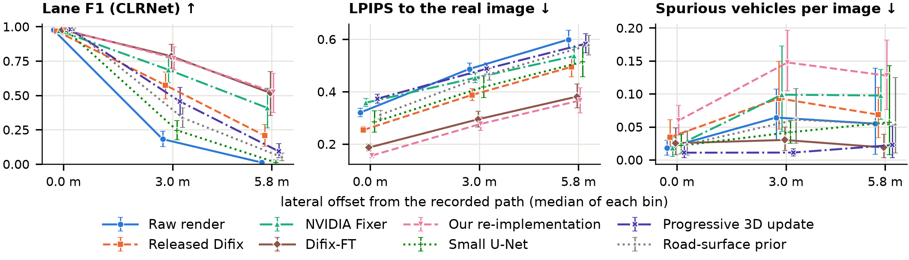
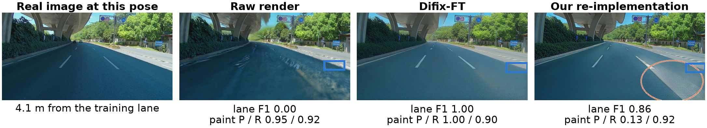

# How Far Off the Recorded Path Can a Gaussian-Splat Driving Simulator Be Trusted? Mid-Term Report

CS 566 Project Mid-Term Report · Kyle Sha · Allen Xia · 29 Oct 2026

## 1. Summary of Progress
The core study is complete, with the proposed vehicle-agreement score replaced (Section 4), and every extension and stretch goal has a first result. We reconstruct Gaussian splats [1] (with gsplat [2]) of eight held-out Para-Lane [3] roads from one lane each, render them at the recorded poses of the neighboring lanes, and compare the renders with the real images captured there. Fixers are generative models that repair a rendered image; the ones we train or fine-tune use pairs from five other roads (Section 4), with checkpoints selected on a sixth. We compare eight methods on all roads:

- *Raw render* of the splat.
- *Released Difix* [4] and *NVIDIA Fixer* [5], NVIDIA's single-view fixers; the reference-view *released Difix-ref* is run on four roads.
- *Difix-FT:* released Difix fine-tuned on our pairs.
- *Our re-implementation* of the Difix training procedure, in the reference-view variant, which also receives an image from the recorded path.
- *Small U-Net* trained from scratch on our pairs.
- *Progressive 3D update* of Difix3D+: views repaired by our re-implementation are added as training images for the splat.
- *Road-surface prior* after ViSE [6], which generates no image content.

Each output is compared with the real image:

- *Lane F1:* following ReconDreamer [7], but against the real image, CLRNet [8] lanes on both are matched at IoU ≥ 0.5 as in CULane.
- *Image similarity:* PSNR and LPIPS [9], with moving objects masked.
- *Paint precision and recall:* lane-paint pixels with a 3-pixel tolerance; low precision means invented paint, low recall erased paint.
- *Spurious vehicles:* YOLO11 [10] vehicle and person detections that the real image's moving-object mask covers by less than 30%.

Offsets fall into three bins: on the path (below 1 m), ~3 m (1–4.5 m) and ~6 m (above 4.5 m). Intervals are 95% bootstrap intervals over lane-pair sequences (34 at ~3 m, 18 at ~6 m) or, where marked "over roads", over the eight roads' paired differences from the raw render.

| Tier | Item | Status |
|---|---|---|
| Core | Splats, raw render, released fixers, evaluation; Difix training re-implementation | Complete (8 roads; re-implementation validated on the DL3DV sample) |
| Extensions | Small U-Net, road-surface prior, progressive update, more roads | Complete (8 roads) |
| Extensions | Heading | Partial (2 of 8 roads) |
| Stretch | Camera height | Partial (warp on 2 roads; MV2 pairs also offset laterally) |
| Stretch | Cross-dataset (EUVS [11] on MARS [12]; MV2 [13]) | Partial (EUVS rotation-only setting not run) |
| Stretch | FaithFusion [14] | Partial (map on 2 roads; map-weighted update on 1) |
| Stretch | Closed loop in HUGSIM [15] | Partial (one driving policy, LTF [16]) |
| Added | Our own splat renderer | Complete |

## 2. Current Results
*Trust falls quickly off the recorded path.* On the path every method agrees with the real image (lane F1 0.96–0.98). For the raw render, lane F1 falls to 0.18 [0.13, 0.24] one lane over (median 3.0 m) and to 0.01 two lanes over (median 5.8 m); the best fixers reach 0.79 and 0.53 (Figure 1, Table 1). Related work sees similar drops: KITScenes [17] reports a 79–86% fall in traffic-sign recall at ±3 m, and RGE-GS [18] reports 16.1 dB PSNR for plain 3DGS about 3.5 m off the path on Para-Lane (our raw render: 18.3 dB at 3.0 m).

*Figure 1. Lane agreement, perceptual distance and spurious vehicles against lateral offset, pooled over eight held-out roads.*

| Method | Lane F1, ~3 m | Lane F1, ~6 m | LPIPS, ~3 m | Paint P / R, ~3 m | Spurious vehicles / image, ~3 m |
|---|---|---|---|---|---|
| Raw render | 0.18 [0.13, 0.24] | 0.01 | 0.49 | 0.50 / 0.52 | 0.064 |
| Released Difix | 0.57 [0.47, 0.67] | 0.21 | 0.39 | 0.53 / 0.58 | 0.093 |
| NVIDIA Fixer | 0.69 [0.59, 0.78] | 0.41 | 0.45 | 0.62 / 0.58 | 0.099 |
| Difix-FT | 0.79 [0.70, 0.87] | 0.52 | 0.29 | 0.63 / 0.63 | 0.030 |
| Our re-implementation | 0.77 [0.68, 0.85] | 0.53 | 0.28 | 0.57 / 0.60 | 0.148 |
| Small U-Net (from scratch) | 0.25 [0.18, 0.32] | 0.01 | 0.42 | 0.57 / 0.38 | 0.042 |
| Progressive 3D update | 0.46 [0.36, 0.56] | 0.09 | 0.49 | 0.66 / 0.49 | 0.011 |
| Road-surface prior | 0.34 [0.27, 0.41] | 0.05 | 0.47 | 0.57 / 0.56 | 0.061 |

*Table 1. Pooled results over eight roads (2,825 images at ~3 m, 1,386 at ~6 m).*

*Fixers trained on our pairs restore the most lane geometry.* Paired on the same frames at ~3 m, Difix-FT exceeds NVIDIA Fixer, the strongest released fixer, by +0.10 [+0.07, +0.13] lane F1, on all eight roads; our re-implementation exceeds it by +0.08 [+0.04, +0.13], on seven, and beats released Difix-ref on each of the four roads where both ran. The progressive update gains +0.33 [+0.19, +0.49] over roads at ~3 m but little at ~6 m, the road-surface prior gains less but on every road, and the small U-Net gains little. Results vary strongly by road: the best fixer reaches lane F1 0.95 on a curved road but at most 0.39 under an elevated highway. Traffic does not drive these results: on the 75% of frames with no moving object in the lower half of the real image, the ranking at ~3 m is unchanged and lane F1 rises by at most 0.05.

*Fixers also add content that is not there.* Our re-implementation adds spurious vehicles on all eight roads (+0.089 per image, [+0.062, +0.117] over roads), Difix-FT does not on average (−0.028 [−0.066, +0.001]), and the progressive update has the fewest. The raw render's own rate (0.064) compares with 0.018 on the path, where traffic matches, so it comes mostly from the render rather than detector noise. On average every method has a higher paint precision than the raw render, but one lane over it falls by at least 0.5 on 1.2% of frames for our re-implementation and 1.9% for the progressive update (at most 0.3% for the others). Figure 2 shows such a frame: our re-implementation paints a marking that is absent from the real road (paint precision 0.13 versus 0.95 for the raw render) while its lane F1 is 0.86; released Difix-ref invents the same marking (not shown), and Difix-FT does not.

*Figure 2. A frame one lane over (4.1 m), chosen by a fixed rule on scenes 16 and 17: the largest invented marking among the frames where released Difix or our re-implementation lost the most paint precision. Orange: invented paint; blue: erased paint.*

*Further results* are summarized in Table 2.

| Study | Finding |
|---|---|
| Difix training re-implementation, from SD-Turbo [19] on the DL3DV [20] sample | Beats the official trainer in a matched single-view setting (LPIPS 0.218 versus 0.237; FID [21] 26.1 versus 36.3); with a reference view, within 0.005 LPIPS of released Difix-ref |
| Heading, up to ±15° (2 roads) | Raw-render lane F1 only falls from 0.98 to 0.94, against the real image warped by the same rotation |
| Camera height, ±1 m (2 roads) | Road-region PSNR falls by 4.9–7.2 dB and lane F1 to 0.49 (+1 m) and 0.02 (−1 m); fixers recover at most 0.10 |
| Other datasets (EUVS/MARS, MV2) | Para-Lane-trained fixers transfer only partly: on MV2 they gain less LPIPS than released Difix-ref (0.05–0.14 versus 0.10–0.16) |
| Closed loop (HUGSIM, LTF policy, 25 scenarios) | No fixer improves the driving score (0.408 without a fixer; paired −0.051 to −0.005 for three fixers; an earlier U-Net −0.21); the policy spends 73% of its steps more than 1 m off the recorded path |
| FaithFusion (2 roads) | Its information-gain map predicts wrongly changed pixels less well than the splat's missing coverage (AUROC 0.53–0.67 versus 0.64–0.77) |
| Our own renderer | Matches gsplat to 90.8 dB PSNR; a full refit is within 0.07 dB of gsplat fits and takes 1.44 times as long |

*Table 2. Further results (raw render unless a method is named).*

## 3. Difficulties Encountered
- *Official Difix trainer.* It needed five patches, ignores its step limit and exceeds 24 GB of GPU memory with the reference view, so the matched comparison is single-view.
- *Data access.* DL3DV granted only its sample release; EUVS's rotation-only setting needs separately licensed nuPlan data.
- *Ground truth across lanes.* The lanes were driven at different times, so traffic differs between render and real image. Moving objects are masked in the image and paint metrics, and the traffic check above bounds the effect on lane F1.
- *Camera height.* MV2's metric scale rests on an assumed 1.40 m camera height and its two vehicles are 7.6 m apart laterally, so height relies mainly on a road-plane warp.
- *Paint masks.* The paint detector also responds to hard shadows and bright curbs on four roads. Frames whose output paint does not overlap the real paint score precision 0 (8–12% one lane over); excluding them leaves every method above the raw render.
- *Third-party software.* FaithFusion's restorer is unreleased; NVIDIA Fixer runs through our own compatibility layer for Transformer Engine, checked only visually; other HUGSIM policies need an older CUDA stack.
- *Small fixer and renderer.* The U-Net trained from scratch falls far short of the diffusion fixers. Our renderer was 12 times slower than gsplat per training step until we restructured its matrix products (now 1.7 times).

## 4. Changes to the Proposal
The research question, data and main comparison are unchanged, and the extensions and stretch goals scheduled for 10/30–11/20 already have first results.

- *Vehicle agreement* is replaced by the spurious-vehicle count, because traffic differs between the recordings and vehicles do not correspond. Agreement on static objects is low even on the path (YOLO11 F1 0.48), so it is not a main metric.
- *Training pairs.* Besides the 3,320 neighboring-lane pairs that the proposal named, training uses Difix3D+'s renders from briefly trained splats (5,150) and from splats fitted to shifted renders (1,830), plus 1,600 identity pairs (near-perfect renders at training poses), added because an early prototype lowered on-path PSNR from 25.6 to 22.6 dB.
- *Methods.* FaithFusion is used through its information-gain map (how well the reconstruction already supports each pixel). The progressive update uses two coarse steps, since a schedule closer to the paper's gave lower lane F1 on one road (0.77 versus 0.90). Difix-FT and our own renderer were added.
- *Deliverables.* The side-by-side videos do not yet mark invented content, and the planned separate tables for the secondary studies are condensed into Table 2.

We plan to complete the partial items by 11/20:

| Dates | Remaining tasks |
|---|---|
| 10/30–11/20 | Heading and camera height on all eight roads; released Difix-ref on the other four roads; the information-gain map and map-weighted update on all eight roads; our re-implementation and a second driving policy in the closed loop (UniAD or VAD, if their older CUDA stack can be built); EUVS's rotation-only setting if nuPlan access is granted. Mark invented content in the videos; prepare the code for release. |
| 11/21–12/10 | Final figures and per-road analysis; presentation (12/1–12/10); project webpage with downloadable code (12/10) |

## References
[1] B. Kerbl et al. 3D Gaussian Splatting for Real-Time Radiance Field Rendering. ACM TOG (SIGGRAPH), 2023.  
[2] V. Ye et al. gsplat: An Open-Source Library for Gaussian Splatting. arXiv:2409.06765, 2024.  
[3] Z. Ni et al. Para-Lane: Multi-Lane Dataset Registering Parallel Scans for Benchmarking Novel View Synthesis. 3DV, 2025.  
[4] J. Z. Wu et al. Difix3D+: Improving 3D Reconstructions with Single-Step Diffusion Models. CVPR, 2025.  
[5] NVIDIA. Fixer. github.com/nv-tlabs/Fixer, 2025.  
[6] K. Tan et al. ViSE: A Systematic Approach to Vision-Only Street-View Extrapolation. arXiv:2510.18341 (RealADSim challenge, ICCV 2025 workshop), 2025.  
[7] C. Ni et al. ReconDreamer: Crafting World Models for Driving Scene Reconstruction via Online Restoration. CVPR, 2025.  
[8] T. Zheng et al. CLRNet: Cross Layer Refinement Network for Lane Detection. CVPR, 2022.  
[9] R. Zhang et al. The Unreasonable Effectiveness of Deep Features as a Perceptual Metric. CVPR, 2018.  
[10] G. Jocher and J. Qiu. Ultralytics YOLO11. github.com/ultralytics/ultralytics, 2024.  
[11] X. Han et al. Extrapolated Urban View Synthesis Benchmark. ICCV, 2025.  
[12] Y. Li et al. Multiagent Multitraversal Multimodal Self-Driving: Open MARS Dataset. CVPR, 2024.  
[13] S. B. Dharavath et al. MV2: Multi-View Multi-Vehicle Driving Dataset for Novel View Synthesis. ECCV, 2026.  
[14] Y. Wang et al. FaithFusion: Harmonizing Reconstruction and Generation via Pixel-wise Information Gain. CVPR, 2026.  
[15] H. Zhou et al. HUGSIM: A Real-Time, Photo-Realistic and Closed-Loop Simulator for Autonomous Driving. IEEE TPAMI, 2026.  
[16] K. Chitta et al. TransFuser: Imitation with Transformer-Based Sensor Fusion for Autonomous Driving. IEEE TPAMI, 2023.  
[17] R. Schwarzkopf et al. The Road Ahead in Autonomous Driving: The KITScenes Multimodal Dataset. arXiv:2606.02956, 2026.  
[18] S. Du et al. RGE-GS: Reward-Guided Expansive Driving Scene Reconstruction via Diffusion Priors. arXiv:2506.22800, 2025.  
[19] A. Sauer et al. Adversarial Diffusion Distillation. ECCV, 2024.  
[20] L. Ling et al. DL3DV-10K: A Large-Scale Scene Dataset for Deep Learning-based 3D Vision. CVPR, 2024.  
[21] M. Heusel et al. GANs Trained by a Two Time-Scale Update Rule Converge to a Local Nash Equilibrium. NeurIPS, 2017.
